<!-- _class: lead -->

# The probes

Code indexers that also record verification statuses

<span class="small">Examples: spqr-verify (Rust + Lean, Aeneas) and secure-messaging (Lean + Verso blueprint). All numbers and diagrams come from probe output. The last slide lists the files.</span>

---

## What a probe does

A probe reads a project with the language's own tools and writes a JSON file. The file has one entry for each **atom**: a function, definition, theorem or spec.

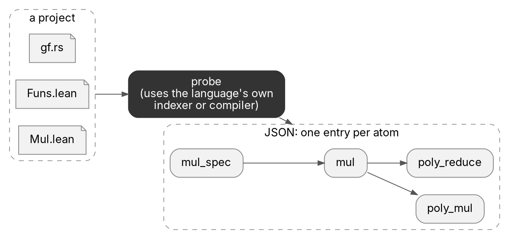

For each atom, the file records its name, its file and lines, the atoms it depends on, and what the verifier or compiler said about it.

A probe records what `lake build`, Verus or the Lean kernel already decided.

---

## One atom: a Rust function and its Lean translation

<div class="cols">
<div>

```rust
// src/encoding/gf.rs, lines 444-446
pub const fn mul(a: u16, b: u16) -> u16 {
    super::reduce::poly_reduce(poly_mul(a, b))
}
```

```json
"probe:spqr/1.6.0/encoding/gf/unaccelerated/mul()": {
  "kind": "exec", "language": "rust",
  "code-path": "src/encoding/gf.rs",
  "code-text": { "lines-start": 444, "lines-end": 446 },
  "dependencies": [
    "probe:spqr/1.6.0/encoding/gf/reduce/poly_reduce()",
    "probe:spqr/1.6.0/encoding/gf/unaccelerated/poly_mul()" ],
  "maps-to": [ { "target": "probe:spqr.encoding.gf.unaccelerated.mul",
                 "method": "charon-def-id", "confidence": "exact" } ],
  "untracked": false,
  "verification-status": "verified",
  "status-origin": "translation"
}
```

</div>
<div>

```lean
-- SrcTranslated/Funs.lean (generated by Aeneas)
def encoding.gf.unaccelerated.mul
  (a : Std.U16) (b : Std.U16) : Result Std.U16 := do
  let i ← encoding.gf.unaccelerated.poly_mul a b
  encoding.gf.reduce.poly_reduce i
```

```json
"probe:spqr.encoding.gf.unaccelerated.mul": {
  "kind": "def", "language": "lean",
  "code-path": "SrcTranslated/Funs.lean",
  "code-text": { "lines-start": 5465, "lines-end": 5471 },
  "type-dependencies": [],
  "term-dependencies": [
    "probe:spqr.encoding.gf.reduce.poly_reduce",
    "probe:spqr.encoding.gf.unaccelerated.poly_mul" ],
  "mapped-from": [ { "target":
    "probe:spqr/1.6.0/encoding/gf/unaccelerated/mul()" } ],
  "primary-spec": "probe:spqr.encoding.gf.unaccelerated.mul_spec",
  "verification-status": "transitively-verified"
}
```

</div>
</div>

<span class="small">Fields trimmed. In Lean, `type-dependencies` are names used in the statement and `term-dependencies` are names used in the body or proof.</span>

---

## The probe family

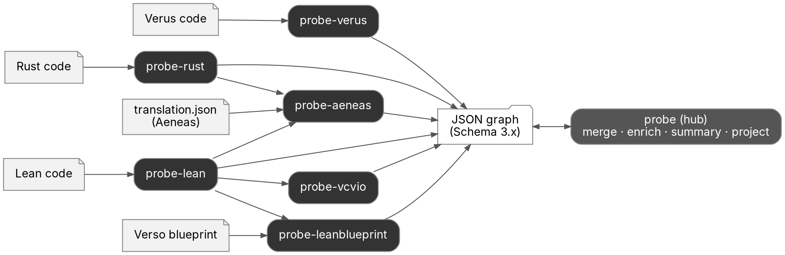

---

## What each probe reads and adds

| Tool | Reads | Adds |
|---|---|---|
| probe-rust | Rust, through rust-analyzer | call graph |
| probe-verus | Verus, through verus-analyzer and `cargo verus verify` | call graph, specs, verification status |
| probe-lean | Lean, through Lean metaprogramming and the kernel | dependency graph, sorry and axiom detection |
| probe-aeneas | probe-rust + probe-lean output, Aeneas `translation.json` | Rust↔Lean links, status for Rust functions |
| probe-leanblueprint | probe-lean output, Verso blueprint | blueprint nodes and their statuses |
| probe-vcvio | probe-lean output of a VCVio project | security-protocol classification: scheme, construction, correctness, security |
| probe (hub) | any of the above | `merge`, `enrich`, `summary`, `project` |

---

<!-- _class: lead -->

# Example 1: spqr-verify

Rust code translated to Lean by Aeneas, then proved in Lean

---

## How probe-aeneas builds the graph

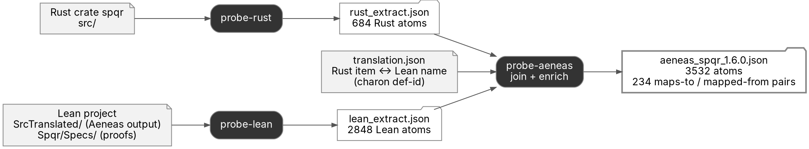

Each language probe sees only its own language. probe-aeneas joins the two graphs. The join uses `translation.json`, which Aeneas writes: for each Rust item it gives the Lean name, keyed by charon def-id.

The join does not add edges to `dependencies`. It adds **correspondence records**: `maps-to` on the Rust atom and `mapped-from` on the Lean atom.

---

## One function across three layers

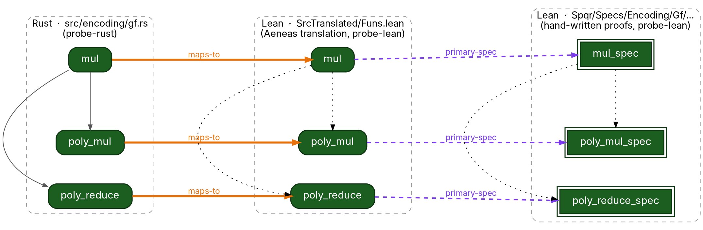

<span class="small">Dark green: `transitively-verified`. Grey lines: Rust `dependencies`. Dotted: Lean `term-dependencies`. Orange: `maps-to`. Purple: `primary-spec`. Each spec's statement also names its function (`type-dependencies`). Those edges are not drawn.</span>

---

## Verification status

| Status | Meaning | Colour |
|---|---|---|
| `transitively-verified` | verified, and everything it depends on is verified | <span class="chip tv">dark green</span> |
| `verified` | its own body or proof is complete, but not everything below it is verified, or the status is imported | <span class="chip v">light green</span> |
| `unverified` | contains `sorry`, `admit` or `assume` | <span class="chip unv">yellow</span> |
| `failed` | the verifier rejects it | <span class="chip fail">red</span> |
| `trusted` | accepted without proof: axioms, Verus `external_body`, external or opaque Lean declarations | <span class="chip tr">purple</span> <!-- enum-ok --> |
| no status | tracked, but has no spec yet | <span class="chip none">white</span> |
| `untracked: true` | out of scope (for example, code behind an inactive `cfg`) | <span class="chip unt">grey</span> |

The probes write the status. VeriLib and other consumers choose the colours. This deck uses the VeriLib colours.

---

## Status of the spqr Rust functions

A Rust function gets a status only from its Lean counterpart. If the Lean translation has a proved `primary-spec`, the Rust function is `verified` with `status-origin: "translation"`. That marker means the evidence is imported. The hub never promotes such a status to `transitively-verified`.

<div class="bar">
  <div class="v f183">183 verified (spec proved in Lean)</div>
  <div class="none f51">51 translated, no spec</div>
  <div class="none f8">8</div>
</div>

<span class="small">242 tracked Rust functions (test code excluded). The 8 at the right have no Lean translation. Another 128 functions are `untracked`: 121 `cfg-inactive`, 6 `trait-signature`, 1 `non-library-target`.</span>

---

## How status spreads

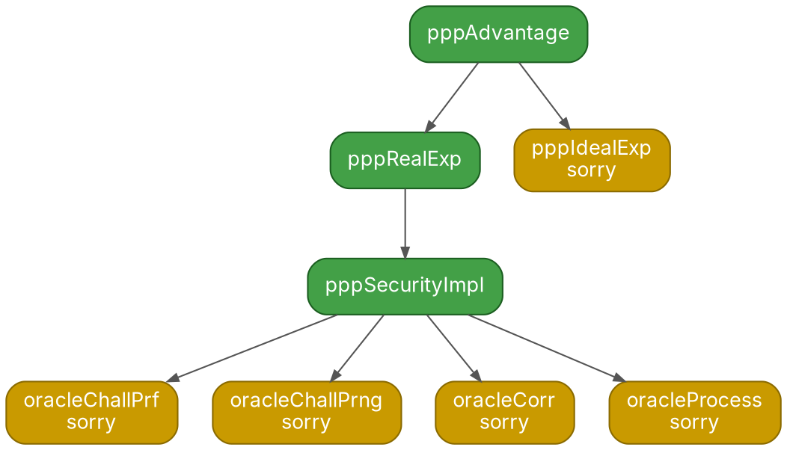

`pppSecurityImpl` has no `sorry` in its own body, so it is `verified`. Four functions it calls contain `sorry`, so it is not `transitively-verified`. Its `assumptions` field lists `sorryAx`. Everything that depends on it inherits the same problem.

<span class="small">This is the only sorry cluster in secure-messaging (`SecureMessaging/PRFPRNG/Defs.lean`): 8 unverified atoms, 3 verified, all others transitively-verified.</span> <!-- enum-ok -->

---

<!-- _paginate: true -->

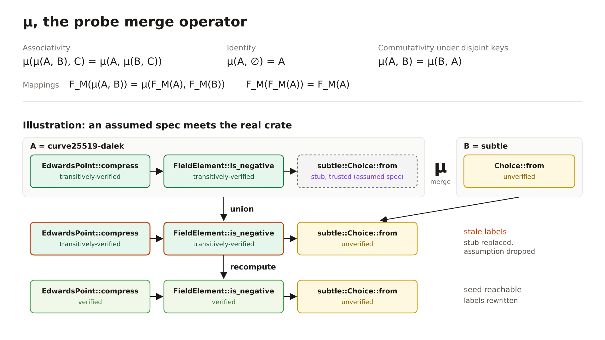

---

<!-- _class: lead -->

# Example 2: secure-messaging

A Lean project with a Verso blueprint: the paper-level plan, linked to the Lean code

---

## How probe-leanblueprint builds the graph

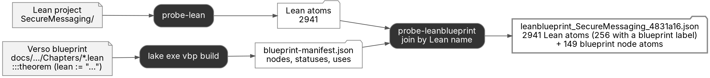

A blueprint entry names its Lean declaration: `:::theorem "opp_unikem_cka_correctness" (lean := "oppUniKemCKA.correctness_true_ge")`. probe-leanblueprint uses that name to join the blueprint with the probe-lean atoms.

It adds one atom for each blueprint node (`language: "blueprint"`) and adds blueprint fields to the Lean atoms it is bound to. probe-lean's `verification-status` stays the authority.

---

## The SCKA chapter as the blueprint sees it

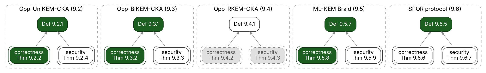

<span class="chip tv">formalized / fully-proved</span> <span class="chip none">ready / ready</span> <span class="chip unt">blocked / none</span> <span class="small">(blueprint statement status / proof status)</span>

Correctness is proved for three of the five constructions. No security theorem is formalized yet, and Opp-RKEM-CKA is blocked.

<span class="small">Edges: `blueprint-statement-uses`. Every correctness theorem also uses Def 9.1.3 (SCKA correctness) and every security theorem uses Def 9.1.4 (SCKA security). Those edges are not drawn.</span>

---

## Blueprint Theorem 9.2.2, down to the Lean code

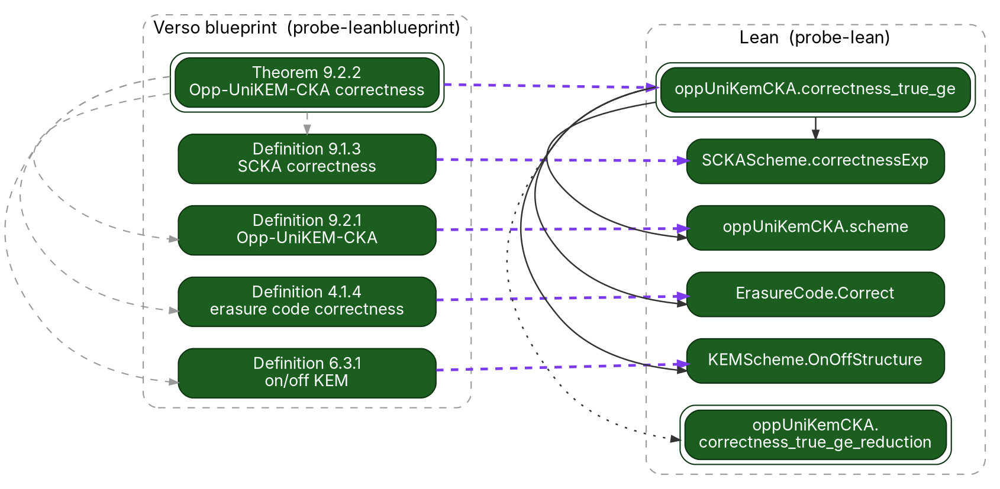

<span class="small">Purple: the Lean declaration each blueprint node is bound to. Grey dashed: `blueprint-statement-uses`. Solid: Lean `type-dependencies` (statement). Dotted: `term-dependencies` only (proof). The blueprint's statement edges match the Lean theorem's statement edges.</span> <!-- enum-ok -->

---

## probe-vcvio: the same project, classified from the code

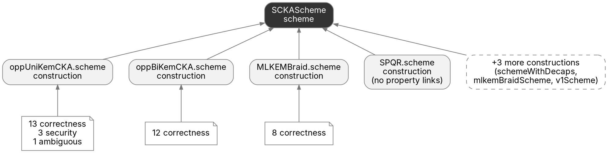

probe-vcvio reads the probe-lean output of a VCVio project. It adds a `classification` to each atom (`scheme`, `construction`, `correctness`, `security`), with links to the construction and scheme.

The blueprint is the plan that people write. The classification comes from the code. They agree: probe-vcvio finds correctness properties for the same three constructions whose correctness theorems the blueprint marks as proved.

<span class="small">363 of 2941 atoms classified. Most properties are found by name, the weakest signal. secure-messaging does not use explicit tags such as `@[security_spec]` yet.</span>

---

<!-- _class: lead -->

# Who uses the JSON

---

## Consumers

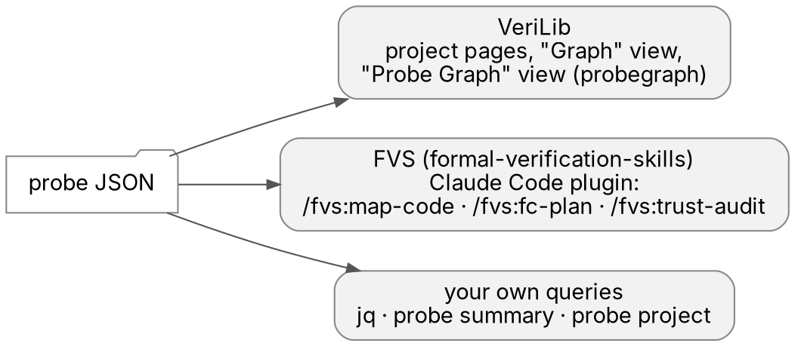

- **VeriLib** shows projects with their atoms and status. probegraph is now the **Probe Graph** view, next to the Graph view. Example: [verilib.org/r/baifdemoa/keyedverificationanonymouscredential-model-8?view=callgraph](https://verilib.org/r/baifdemoa/keyedverificationanonymouscredential-model-8?view=callgraph)
- **FVS** (formal-verification-skills) runs probe-aeneas and builds a work list: functions in scope, entry points, functions without a Lean spec, status counts. `/fvs:trust-audit` runs `#print axioms` on each spec.
- **Your own queries**: the JSON is plain data, so `jq` is enough.

---

## Queries: the same graph, three questions

<div class="cols3">
<div>

**Entrypoints**
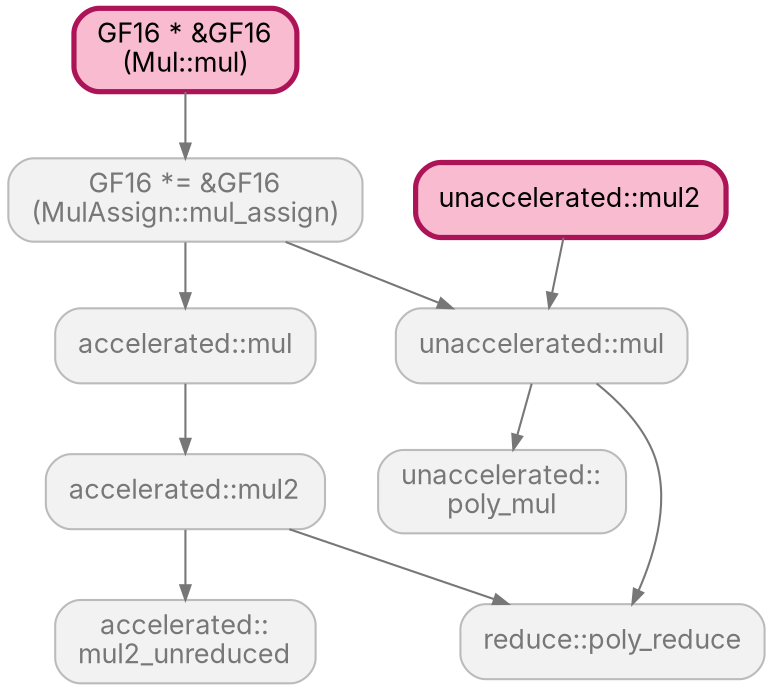
35 in spqr, including `send`, `recv`, `initial_state`

</div>
<div>

**Rust functions without a translation**
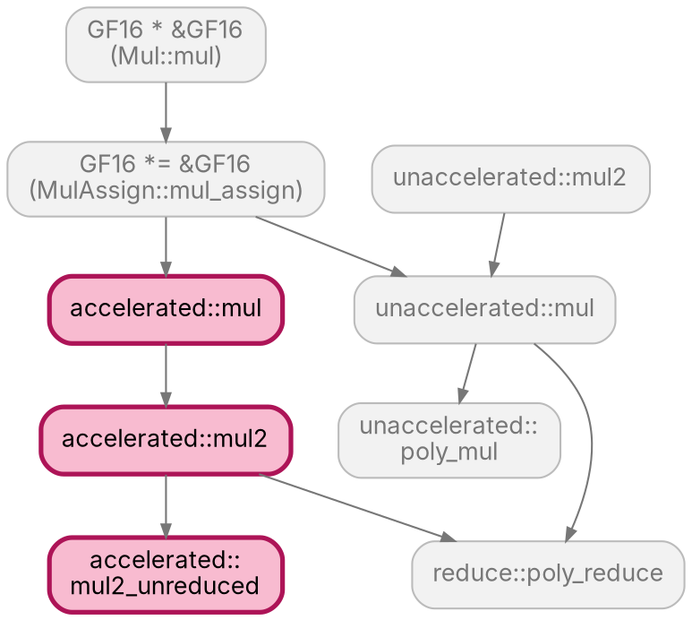
8 in spqr: the SIMD path `accelerated::*` and 5 more

</div>
<div>

**Verified Rust functions**
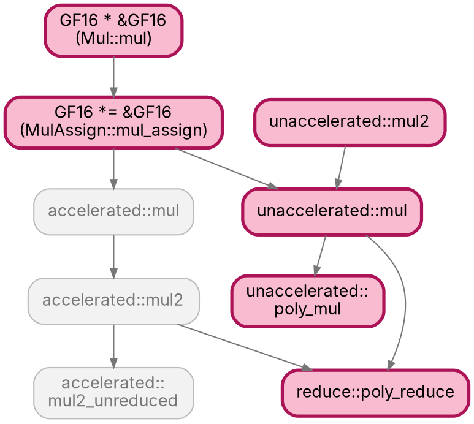
183 in spqr

</div>
</div>

<span class="small">The `encoding/gf` multiplication code of spqr. Pink: the query result. Edges: Rust `dependencies`.</span>

---

## The queries in jq

```bash
# Entrypoints: tracked Rust functions that no non-test code calls
jq -r '.data as $d
  | def tracked: .language == "rust" and .kind == "exec" and .untracked == false
                 and .["code-path"] != "" and (.["code-module"] | contains("test") | not);
    ([$d[] | select(.["code-module"] | contains("test") | not) | .dependencies[]] | unique) as $called
  | $d | to_entries[] | select((.value | tracked) and (.key as $k | $called | index([$k]) | not))
  | .key' aeneas_spqr_1.6.0.json

# Rust functions without a translation
jq -r '.data | to_entries[]
  | select(.value.language == "rust" and .value.kind == "exec" and .value.untracked == false
           and .value["code-path"] != "" and (.value["code-module"] | contains("test") | not)
           and .value["maps-to"] == null)
  | .key' aeneas_spqr_1.6.0.json

# Verified Rust functions
jq -r '.data | to_entries[]
  | select(.value.language == "rust" and .value["verification-status"] == "verified")
  | .key' aeneas_spqr_1.6.0.json
```

---

## More queries

```bash
# Everything the statement and proof of mul_spec use (86 atoms in spqr)
jq -r --arg root probe:spqr.encoding.gf.unaccelerated.mul_spec '.data as $d
  | def next: $d[.] // {} | (.["type-dependencies"] // []) + (.["term-dependencies"] // []) | .[];
    [$root | recurse(next)] | unique | .[] | select(. != $root)' aeneas_spqr_1.6.0.json

# Blueprint theorems that are not fully proved (40 of 63 in secure-messaging)
jq -r '.data[] | select(.language == "blueprint" and .["blueprint-kind"] == "theorem"
                        and .["blueprint-proof-status"] != "fully-proved")
  | "\(.["blueprint-title"])  \(.["blueprint-label"])  \(.["blueprint-statement-status"])"' \
  leanblueprint_SecureMessaging_4831a16.json

# Lean atoms that rest on a sorry (11 in secure-messaging)
jq -r '.data[] | select(.language == "lean" and (.assumptions // [] | index("sorryAx")))
  | "\(.["verification-status"])  \(.["display-name"])"' leanblueprint_SecureMessaging_4831a16.json
```

`probe summary` gives entrypoints, verified functions and lemmas for Verus and Lean projects. For an Aeneas project it lists the Rust results under "Imported" (183 for spqr), because their status comes from Lean.

---

## probegraph: these queries with a user interface

The search box of the Probe Graph view accepts query words. Each one reads probe fields.

| Query word | Probe fields it reads |
|---|---|
| `kind:theorem`, `status:unverified,failed` | `kind`, `verification-status` |
| `module:gf`, `file:gf.rs`, `crate:spqr` | `code-module`, `code-path`, code-name |
| `level:0` | `dependencies` (dependency levels) |
| `is:unfinished` | `verification-status` is `unverified` or `failed`, and not an axiom |
| `is:assumption` | `kind: axiom` or `verification-status: trusted` |
| `is:unused` | nothing depends on it (`dependencies`) |
| `is:surface` (Aeneas) | `is-public-api`, and no Lean counterpart |
| `paths from X to Y`, `top 10 by dependents` | `dependencies` |

<span class="small">Source: `web/src/query-words.ts` in probegraph.</span>

---

## Try it

```bash
# Aeneas project: runs probe-rust and probe-lean, joins them
probe-aeneas extract path/to/aeneas-project
# -> .verilib/probes/aeneas_<crate>_<version>.json

# Lean project with a Verso blueprint
probe-leanblueprint extract path/to/lean-project
# -> .verilib/probes/leanblueprint_<package>_<commit>.json

# VCVio project: classify an existing probe-lean output
probe-vcvio extract path/to/lean-project --lean probe-lean-extract.json -o out.json

# Summary and focused subgraphs (hub)
probe summary <file>.json
probe project <file>.json --help
```

Documentation: the hub `kb/` (schema in `kb/engineering/schema.md`) and `docs/USAGE.md` in each probe repository.

---

## Data used in this deck

| Project | Commit | Tool | File |
|---|---|---|---|
| spqr-verify | `01245a1` | probe-aeneas 0.21.0 (probe-rust 0.12.0, probe-lean 0.21.0) | `aeneas_spqr_1.6.0.json`: 684 Rust + 2848 Lean atoms |
| secure-messaging | `4831a16` | probe-leanblueprint 0.10.0 (probe-lean 0.20.0) | `leanblueprint_SecureMessaging_4831a16.json`: 2941 Lean + 149 blueprint atoms |
| secure-messaging | `4831a16` | probe-vcvio 0.1.0 over the same probe-lean output | `vcvio_SecureMessaging_4831a16.json`: 363 classified atoms |

Counts that exclude test code use the same rule as `probe summary`: `code-module` or `display-name` contains "test".

Diagram sources: `docs/img/intro/*.dot` (Graphviz). Every node, colour and edge is a field in these files.
